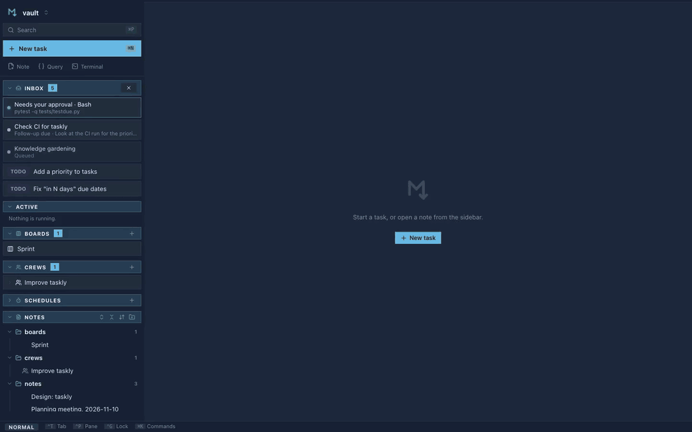

<div align="center">
  

<h1>Marq</h1>

<h3>Run agents. Keep everything.</h3>

[](https://github.com/harehare/marq/actions/workflows/ci.yml)

**A Markdown knowledge base and an IDE for coding agents, in one app.**

Run coding agents in parallel, and keep every prompt, session, task and doc they produce as Markdown in your vault, ready to search, query, and hand to the next agent.



</div>

Marq runs coding agents in parallel, each in its own git worktree, and keeps everything they do (prompts, sessions, results, tasks) as plain Markdown files next to your notes. Because it is all Markdown, you can query it with [mq](https://github.com/harehare/mq) and hand exactly the parts you pick to an agent.

> [!WARNING]
> Marq is under active development: features, file formats and keybindings may change without notice. It is developed on macOS; Linux and Windows build but are not tested yet.

## Features

### Agent IDE

- **Parallel tasks in git worktrees.** Each task gets its own worktree and branch, so several agents can work on one repository at once.
- **Workspaces.** Give a task several directories, with a worktree for each repository you choose, and save the set as a workspace to pick again.
- **Review in the app.** The **Changes** panel shows the diff against the base commit. Comment on diff lines and send the review back to the agent, then commit, push and create a PR.
- **Run an agent from a note.** Hover a heading and choose **Ask**. The session is linked to the heading, and the result comes back as a card under the section.
- **Crews.** Several sessions work on one project as a team by role, with a shared task list. Kanban boards are Markdown too.
- **Checks, phases and specs.** A request can run a command after each turn and send failures back to the agent (or to a fresh session), have a separate session check hidden acceptance criteria, run in phases with a fresh context each (research → plan → implement, or a playbook such as reproduce → diagnose → fix that you write as a note), and run in Claude Code's sandbox. Specs break down into board cards.
- **Compare agents and models.** Run one task on 2 to 4 runs, Claude models or other agents such as Codex, each in its own worktree, look at the diffs side by side, and keep the one you prefer.
- **Inbox and queues.** What needs you (approvals and errors) and what waits its turn to run (schedules, requests and board cards you queue) sit in one Inbox that survives a restart. Work starts from it one after the other (or as many at once as you set), and a failure stays visible until you dismiss it.
- **Follow-ups and memory.** An agent can set a follow-up for itself ("check the CI run in 30 minutes") and is resumed with its own note when it falls due. Standing instructions (`instructions.md`) and the agent's progress notes carry over between runs.
- **Notifications.** A system notification and a Dock badge when a session finishes, stops with an error or needs an approval, and an unread marker in the sidebar. Bursts are combined into one.
- **Approvals and resume.** Tool calls that need permission show an approval card. Interrupted sessions can be resumed, and you can send follow-ups while an agent is working.
- **Terminal tabs** next to your sessions, for dev servers and builds.
- **Claude, Ollama and ACP agents.** Use your own `claude` login, a local model served by Ollama, or another agent that speaks ACP (Gemini CLI, Codex, OpenCode, Qwen Code, Goose).

### Knowledge base

- **Everything is Markdown.** Notes, requests, session logs, crews, boards and documents written by agents are all `.md` files in your vault. Edit them with any editor; Marq only rewrites the parts between its own markers.
- **Query with mq.** `mq` code blocks run in the preview and show their output right below. The same queries power the todo list, the learnings across sessions, and the Query tab.
- **Pick what the agent sees.** Extract a section with mq, select text in a note or a session, or attach `context:` queries to a request, then send exactly that to an agent.
- **Sessions feed back into notes.** Learnings are written into the session note, and agents can search your notes and save documents to the vault.

## Markdown in, Markdown out

A request is a note. Its body is the prompt, and `context:` attaches pieces of other notes picked with mq:

```markdown
---
type: request
status: todo
project: ~/dev/git/mq
context:
  - query: 'import "section" | nodes | section::find("Design") | section::body()'
    from: notes/design.md
---
# Show types on hover

Implement what the design note says.
```

When the session finishes, Marq writes the result back under `## Result`, and the full transcript to `sessions/`, also Markdown. Because sessions are Markdown, mq can query them as well:

```sh
# Learnings from every session
mq -A 'import "section" | section::find("Learnings") | section::body()' sessions/*.md

# Every command the agent ran
mq 'select(.code.lang == "tool:Bash") | .code.value' sessions/*.md
```

## Quick start

Requirements:

- Rust (stable), Node.js and pnpm (release builds from `just build` bundle the agent sidecar, so Node is only needed to build and develop, not to run the app)
- The `claude` CLI, logged in. Sessions run through the Claude Agent SDK in a Node sidecar (`sidecar/`), using your own `claude` and its login. For Ollama, see [Agents and models](docs/src/agents.md).

```sh
pnpm install     # also installs sidecar/ dependencies
pnpm tauri dev
pnpm check       # type checks, clippy and Rust tests
```

Tasks are collected in the [`justfile`](justfile); run `just` to list them.

| Command | Does |
| --- | --- |
| `just dev` | Run the app from source |
| `just check` | Type checks, clippy and Rust tests |
| `just ci` | Everything CI runs, including the docs build |
| `just build` | Bundle the app (and the sidecar) for this OS |
| `just dist` | Build and gather the installers and `SHA256SUMS` into `dist-app/` |
| `just bump 0.2.0` | Set the version in `package.json`, `Cargo.toml` and `tauri.conf.json` |
| `just docs-serve` / `just site-serve` | Preview the docs, or the landing page with the docs |

See [Building and distribution](docs/src/building.md) for per-OS requirements, CI and releases.

Open a folder as the vault (any folder of Markdown files works), then open a note, hover a heading and choose **Ask**, or press ⌘N for a new task.

## Documentation

| Page | Contents |
| --- | --- |
| [Getting started](docs/src/getting-started.md) | Install, open a vault, your first session, the sidebar |
| [Vault and file formats](docs/src/vault.md) | Folder layout, frontmatter, anchors, result blocks, session files |
| [Sessions](docs/src/sessions.md) | Ask, tasks and requests, worktrees and review, approvals, resume, sending text |
| [Inbox and follow-ups](docs/src/inbox.md) | What waits for you, queued work, agents' follow-ups, standing instructions, notifications |
| [mq queries](docs/src/mq.md) | `mq` code blocks, pinning, built-in queries, picking context for an agent |
| [Crews and boards](docs/src/crews-and-boards.md) | Teams of sessions, the shared task list, kanban boards |
| [Workflows](docs/src/workflows.md) | Checks after each turn, acceptance criteria, phases, the sandbox, specs, skills |
| [Agents and models](docs/src/agents.md) | Claude, Ollama, ACP agents, permission modes, how sessions run |
| [Vault tools for agents](docs/src/tools.md) | The MCP tools agents use to read and organize the vault |
| [Settings and keys](docs/src/settings.md) | `~/.marq/config.toml`, keybindings, shell environment |
| [Building and distribution](docs/src/building.md) | Requirements per OS, `just` recipes, CI, releases, the site |

## Compatibility

| Agent | Status |
| --- | --- |
| Claude (through your `claude` CLI) | Supported |
| Ollama (`ollama:<model>`) | Supported, except for crews |
| Gemini CLI, Codex, OpenCode, Qwen Code, Goose (through [ACP](https://agentclientprotocol.com)) | Supported with limits: no crews, model choice or sandbox |
| Other ACP agents | Add one under `[agents.<id>]` in `config.toml` |

See [Agents and models](docs/src/agents.md) for what each one can do.

mq queries use [mq-lang](https://github.com/harehare/mq) 0.10.1, embedded in the app.
